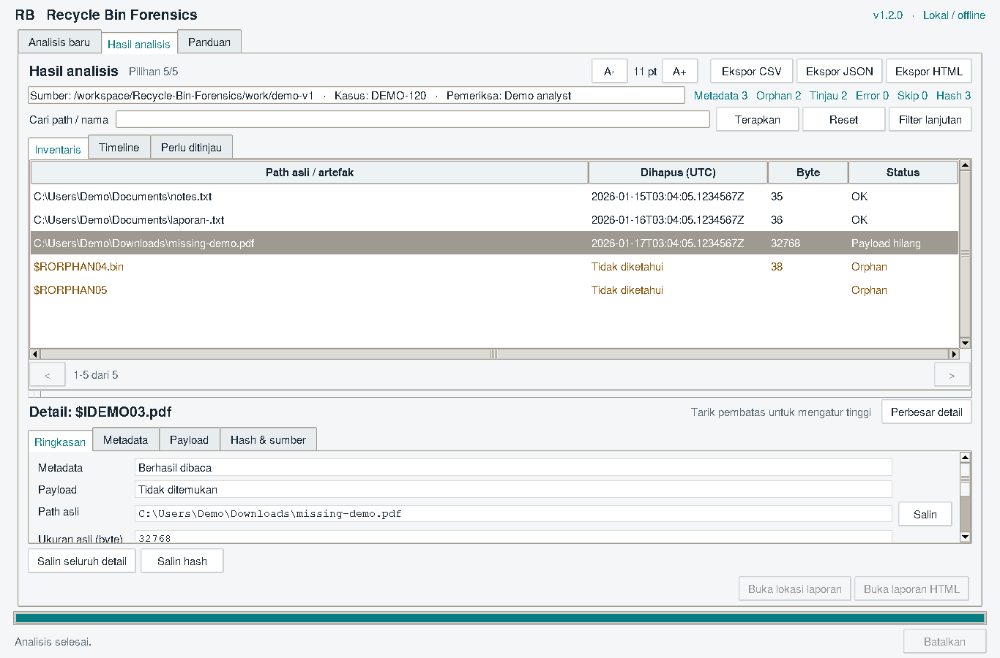

# Recycle Bin Forensics 1.4

An offline desktop application and Python command-line toolkit for examining modern Windows Recycle Bin artefacts. It parses `$I` metadata, inventories sibling and orphan `$R` payloads, selects findings by investigative criteria, builds deletion timelines, and exports JSON, CSV, terminal, or standalone HTML reports.

**Designed for artefact triage, incident-response support, and learning binary forensics.** Analysis reads supplied evidence; it does not restore deleted files, acquire disk images, or identify who performed a deletion. Validate findings against known-good Windows samples and independent case evidence.

## What it does

- Offers a local desktop interface for choosing evidence, scanning, reviewing details, and exporting reports.
- Provides a larger adjustable results workspace, grouped details that can open in a separate window, foldable filters, and text-size controls.
- Sorts the complete desktop selection by path, exact deletion time, size, or status before pagination.
- Keeps the desktop responsive with background work, truthful progress, and cooperative cancellation.
- Parses `$I` format versions 1 and 2, including strict UTF-16LE paths.
- Preserves raw 64-bit FILETIME and seven-digit UTC timestamp fractions.
- Inventories metadata, matching `$R` files/folders, orphan payloads, and discovery problems.
- Reports malformed, unsupported, inaccessible, or truncated items individually.
- Computes SHA-256 for metadata and optionally for regular `$R` files.
- Filters by literal search, extension, SID, original size, and deletion-time bounds.
- Builds an ordered timeline and UTC-day, SID, and extension counts from selected dated metadata.
- Produces an offline HTML report with browser search/sorting, plus JSON, CSV, and terminal output.
- Keeps full scan records in JSON even when a filter selects a smaller view.
- Avoids evidence symlinks/reparse points and refuses to overwrite report files.
- Includes a reproducible synthetic corpus, independent-parser validation, and scan/GUI benchmark tools.

The parser treats decoded Windows paths as evidence text. It never opens those paths on the examiner's computer. Payload correlation uses acquired sibling names. Recursive scans do not enter `$R` payload directories: their contents are data, not another Recycle Bin inventory.

## Start with the desktop app

The desktop interface uses Indonesian labels: **Analisis baru**, **Hasil analisis**, and **Panduan**. It runs locally and uses the same analysis engine and report formats as the CLI. See the [desktop user guide](docs/DESKTOP.md) for the complete workflow.

Version 1.2 places the full-width detail pane below the results table. Drag the separator to adjust their heights, or use **Perbesar detail** to review the selected record in a resizable window. Metadata decoding and payload availability have separate labels, so successful parsing is not confused with available content. Advanced filters can be folded away, and text size can be adjusted for the screen.



The preview uses synthetic data. See also the [compact 1366×768 workspace](docs/images/desktop-compact.png) and [enlarged detail window](docs/images/desktop-detail.png). Native controls and fonts can differ between operating systems.

### Windows portable package

Download a versioned Windows ZIP from [GitHub Releases](https://github.com/nomatterwhathappns/Recycle-Bin-Forensics/releases), compare its SHA-256 with `SHA256SUMS.txt`, extract the portable ZIP, and launch `RecycleBinForensics.exe` from the extracted application folder. Keep the complete folder together; the executable uses its bundled support files. Python does not need to be installed separately for this package.

Each release also includes the Python wheel/source distribution and a synthetic demo dataset. The [desktop guide](docs/DESKTOP.md#windows-portable-package) explains extraction and checksum comparison. Development builds remain available as temporary artifacts from the [Windows package workflow](.github/workflows/windows-package.yml).

### Run from Python

Follow the source installation steps below, then run one of:

```sh
rbf-gui
python -m rbinforensics.gui
rbf gui
```

The desktop requires Tk support in the Python installation and a graphical display. `python -m tkinter` can check that support. Some Linux distributions package Tk separately; use the Tk package matching your Python installation. The portable Windows package bundles Tcl/Tk and timezone data.

## Source installation and CLI

Requires **Python 3.10 or newer**. UTC analysis has no third-party runtime dependencies.

```sh
git clone https://github.com/nomatterwhathappns/Recycle-Bin-Forensics.git
cd Recycle-Bin-Forensics
python -m venv .venv
```

Activate the environment:

```sh
# Linux/macOS
source .venv/bin/activate
```

```powershell
# Windows PowerShell
.venv\Scripts\Activate.ps1
```

```sh
python -m pip install .
rbf --help
rbf --version
```

On hosts without an IANA timezone database, including many Windows installations, install the optional timezone extra for named zones such as `Asia/Jakarta`:

```sh
python -m pip install '.[timezone]'
```

`python -m rbinforensics` is an alternative to the `rbf` command.

## Try it without case evidence

The generator requires a new destination and writes fictitious metadata and harmless payloads. It demonstrates both metadata layouts, Unicode, three deletion days, a missing payload, and orphan file/directory payloads.

```sh
python examples/generate_demo.py work/demo
rbf scan work/demo --recursive
rbf scan work/demo --recursive --hash-payload --format json --output work/demo.json
rbf scan work/demo --recursive --format html --output work/demo.html
```

Open `work/demo.html` in a browser. The report is self-contained; it needs no server, account, CDN, or network connection. Treat report contents as case data: original paths, hashes, and examiner labels can be sensitive.

Use `--include-broken` with a different generator destination to demonstrate partial failures. Generated bytes test implementation behavior; they are not an independently acquired Windows corpus.

## Examine acquired evidence

Use an acquisition or verified working copy, preferably on a read-only mount. Preserve volume/SID folder structure. Put reports outside the evidence directory and use a new filename for every run.

```sh
# A single metadata item; single quotes keep the dollar sign literal.
rbf scan '/cases/working/$IABC123.docx'

# A full inventory with hashes and run labels.
rbf scan /cases/working/recycle-bin --recursive --hash-payload --format json \
  --output /cases/reports/run-001.json --case-id IR-2026-001 --examiner analyst

# Selected documents in a reviewable offline HTML report.
rbf scan /cases/working/recycle-bin --recursive --query finance --extension .pdf \
  --deleted-after 2026-01-01 --deleted-before 2026-01-31T23:59:59.9999999Z \
  --timezone Asia/Jakarta --format html --output /cases/reports/finance.html

# Multiple extensions are alternatives; different filter categories combine with AND.
rbf scan /cases/working/recycle-bin --recursive --extension .pdf --extension .docx \
  --min-size 1024 --max-size 10485760 --format csv --output /cases/reports/documents.csv
```

PowerShell also expands `$` in double quotes. Use single quotes:

```powershell
rbf scan 'D:\Case\Working\$Recycle.Bin' --recursive --format html --output 'D:\Case\Reports\review.html'
```

For `cmd.exe`, use ordinary double-quoted paths:

```bat
rbf scan "D:\Case\Working\$Recycle.Bin" --recursive
```

Prefer `--output` to shell redirection. A shell can truncate a `>` destination before this program runs, bypassing the tool's exclusive creation and destination checks. The report parent directory must already exist; for single-file input, report output must also be outside that file's parent evidence directory.

## Filters, inventory, and timeline

| Option | Meaning |
| --- | --- |
| `--query TEXT` | Case-insensitive literal search across original/acquired paths and source names |
| `--extension .pdf` | Original-path extension; repeat for alternatives; orphan payloads use their acquired filename |
| `--sid SID` | Exact case-insensitive match to the SID-like ancestor recorded by the scanner |
| `--deleted-after VALUE` | Inclusive lower deletion bound |
| `--deleted-before VALUE` | Inclusive upper deletion bound |
| `--min-size BYTES`, `--max-size BYTES` | Inclusive original-size bounds; require metadata |

Date bounds accept `YYYY-MM-DD` as **UTC midnight**, or ISO datetimes with `Z`/an explicit offset. A date-only `--deleted-before 2026-01-31` includes midnight at the start of that date, not its entire day. Use an explicit final seven-digit fraction for a full-day upper bound. Time comparisons retain 100 ns tick precision. Display timezone changes presentation, not filter interpretation.

Directory scans include orphan `$R` files/folders without inventing their original paths, sizes, or deletion timestamps. An orphan means no matching metadata name was found in that directory; it does not prove why metadata is missing. A malformed matching `$I` is still a metadata counterpart, so its payload is not labelled orphan merely because parsing failed. Literal `$Recycle.Bin` containers are not payloads.

JSON retains the **complete inventory and full-scan summary**. `selection` records which indexes are shown; `timeline` summarizes shown, dated metadata. CSV, terminal, and HTML present that selection. Error, skipped, and discovery records remain visible despite filters, and scan failures still affect the exit status. `selection.matched` includes these mandatory diagnostics. Parsed metadata on a diagnostic record can appear in the timeline even if it does not match other requested criteria. A selected view with no findings does not establish absence from the source device.

The timeline sorts by encoded deletion FILETIME. Payload filesystem modification times are not substituted for missing deletion times. Counts and clusters assist triage; they do not identify an actor or establish intent.

### Exit codes

| Code | Meaning |
| --- | --- |
| `0` | Scan completed without record/discovery errors or skipped items; warnings still need review |
| `1` | One or more record/discovery errors or skipped evidence items |
| `2` | Invalid usage/configuration, top-level input/output failure, or no artefact candidates in scope |
| `130` | Interrupted by the operator; the scan is incomplete |

## Understanding the findings

| Finding | What it supports | What it does not establish |
| --- | --- | --- |
| Original path | Path text recorded in `$I` | Current existence or verified original content |
| Deletion FILETIME | Timestamp encoded in the artefact | A trustworthy source clock, user identity, or intent |
| Original size | Size recorded in metadata | Integrity of a remaining payload |
| Sibling `$R` | Matching acquired filename exists | Authenticity or complete recovery |
| Orphan `$R` | A payload-like entry lacks matching metadata in scope | Original name, deletion time, or reason metadata is absent |
| SHA-256 | Fingerprint of the bytes read | Acquisition quality, provenance, or chain of custody |

Reads on writable filesystems can update access times. Hashes and case labels support documentation but do not replace acquisition procedures. Preserve original bytes and corroborate findings with appropriate independent sources.

This release does not parse legacy `INFO2`, carve unallocated space, restore content, parse filesystem journals, or recursively hash directory payloads. Symlink/reparse-point components are rejected. Metadata reads are capped at 128 KiB per file. Payload hashing streams files, but inventory, analysis, and rendering are assembled in memory; partition very large cases into documented scopes.

## Documentation and versioning

- [Synthetic dataset and expected findings](docs/DATASET.md)
- [Independent reference comparison and its limits](docs/VALIDATION_REFERENCE.md)
- [Benchmark method and measured results](docs/BENCHMARKS.md)
- [Release contents and verification](docs/RELEASES.md)

- [Desktop user guide](docs/DESKTOP.md)
- [Indonesian learning guide and critical code walkthrough](docs/LEARNING_ID.md)
- [Binary layouts and parsing decisions](docs/FORMAT.md)
- [Report contract and interpretation](docs/REPORT_SCHEMA.md) and [JSON Schema 2.0](schemas/report-v2.schema.json)
- [Evidence workflow](docs/EVIDENCE_WORKFLOW.md)
- [Controlled Windows validation](docs/VALIDATION_WINDOWS.md)
- [Changes and migration notes](CHANGELOG.md)
- [Contributing](CONTRIBUTING.md) and [security reporting](SECURITY.md)

**Application version `1.4.0` and report schema version `2.0` are separate contracts.** Desktop layout, sorting, text size, progress, and cancellation do not change the completed-report schema. Desktop column sorting changes table presentation, not report ordering. Consumers must check `schema_version`; the historical [schema 1.0](schemas/report-v1.schema.json) remains available for earlier reports.

Feature additions increment the minor version (`1.0.0` to `1.1.0`); compatible bug fixes increment the patch version (`1.1.0` to `1.1.1`). A compatibility-breaking application change increments the major version. Changes are recorded in [CHANGELOG.md](CHANGELOG.md).

To update an existing source checkout on Parrot or another Linux desktop, close the application, enter its repository directory, and run:

```sh
git pull --ff-only
source .venv/bin/activate
python -m pip install '.[timezone]'
rbf --version
rbf-gui
```

The version command should report `rbf 1.4.0`. An update conflict should be resolved without discarding local changes. Source updates do not replace previously exported reports.

## Development and validation

```sh
python -m pip install -e '.[dev]'
python -m pytest
python -m ruff check .
python -m ruff format --check .
python -m build
```

Optional browser regression tests use Playwright with an installed Chromium or Google Chrome:

```sh
python -m pip install -e '.[dev,browser]'
RBF_RUN_BROWSER=1 python -m pytest tests/test_browser_html.py -v
```

Set `RBF_CHROMIUM` to an explicit browser executable if it is not on `PATH`. Browser-test dependencies are not needed to generate or open reports.

The suite includes synthetic byte fixtures, actual filesystem scenarios, filtering/timeline boundaries, report-schema checks, and HTML safety checks. CI exercises supported operating systems and Python versions. Controlled Windows deletion validation is a separate opt-in procedure described in [VALIDATION_WINDOWS.md](docs/VALIDATION_WINDOWS.md). A live runner test represents its particular Windows build/configuration; it is not certification of every Windows release, filesystem, or acquisition method.

Licensed under the [MIT License](LICENSE).
